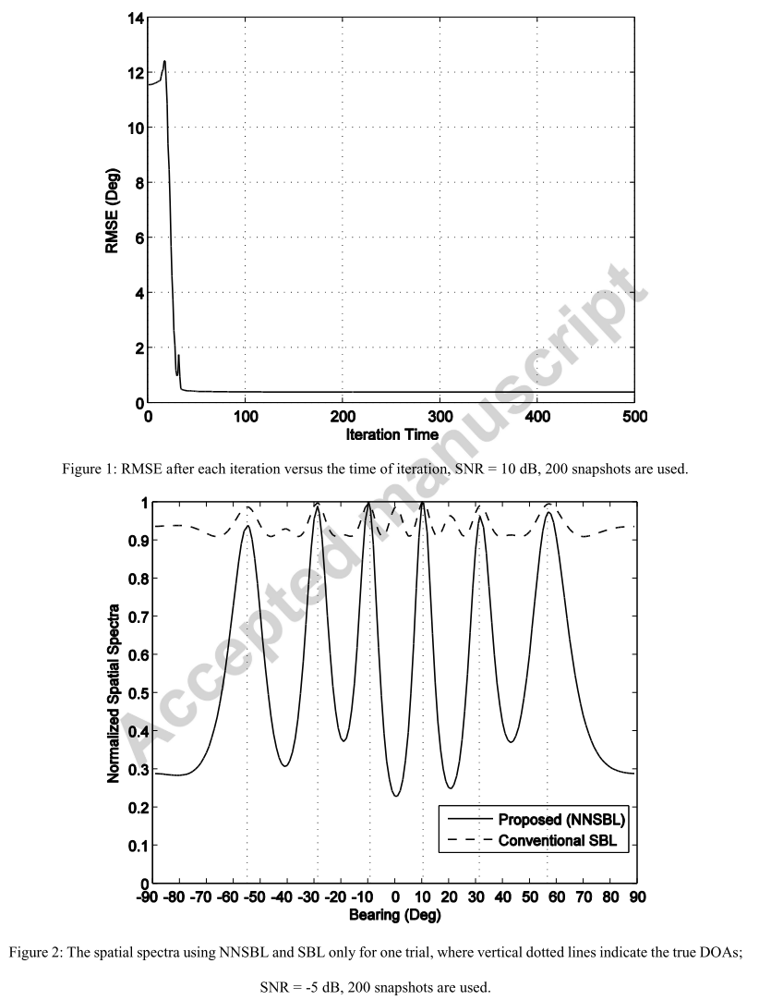
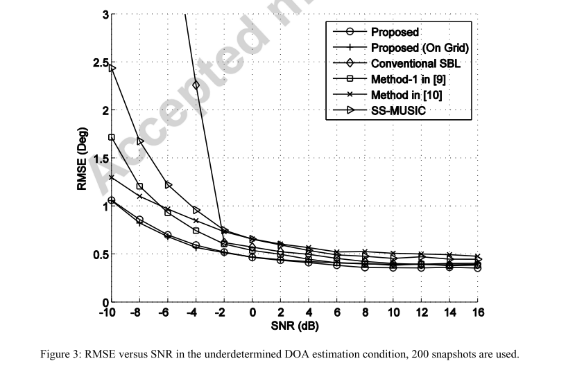
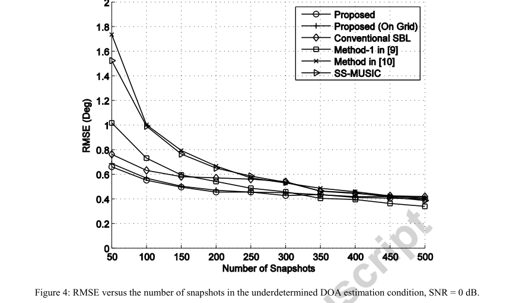
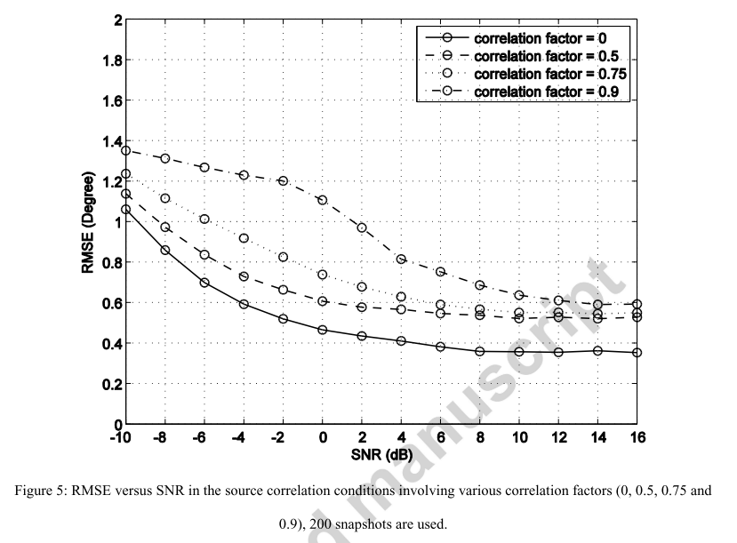

# [Source Localization]Sparse Array Source Localization Based on Non-Negative Sparse Bayesian Learning[with MATLAB Code]

Introduction: Source localization has always been a critical issue in radar, sonar, and wireless communication applications. When considering only the target direction, this problem is also known as "Direction of Arrival (DOA) estimation" [1]. The accuracy of DOA estimation is determined by the degree of freedom (DOF) of the sensor array. For uniformly spaced arrays, increasing the DOF means increasing the number of sensors, which increases manufacturing costs and the difficulty of array calibration [2]. Sparse arrays have attracted widespread attention due to their ability to improve the DOF through sparse placement of sensors, significantly reducing the number of sensors.
The improvement in DOF can be explained through the construction of a virtual array, known as the difference-covariance array [3]. Then, traditional DOA estimation methods, such as MUSIC, can be applied based on this virtual array and the corresponding enlarged covariance matrix [5]. In recent years, the Khatri-Rao (KR) product method [6] has gained widespread attention, as it forms a virtual array simply by vectorizing the covariance matrix. In this context, a series of methods emerged, among which spatial smoothing (SS) techniques are most well-known [7]. In recent years, the problem of direction of arrival estimation has increasingly been viewed as a sparse signal recovery (SSR) problem. By combining the covariance fitting criterion, several SSR-based methods have been designed for sparse arrays [9-12], using basis pursuit denoising (BPDN), which first introduces DOA estimation through 1 -SVD [13]. Among these BPDN methods, the basic regularization hyperparameters are usually determined by the noise variance, as mentioned in [9]. In [10], the noise autocorrelation is weighted by a matrix to remove it, while the information signal autocorrelation is also removed.
Another idea to address the SSR problem is through Sparse Bayesian Learning (SBL), which has the advantage of automatically inferring all relevant parameters and hyperparameters. By introducing prior distributions for the parameters within a Bayesian model, some implicit information in the model can be effectively utilized, often leading to benefits. SBL was first introduced by Tipping [14] for solving the SSR problem, using the method known as Relevant Vector Machines (RVM). A hierarchical Laplace Prior was proposed in [15] instead of the Student-t prior for sparse vectors in RVM, which also corresponds to the 1-norm constraint in BPDN. In [16], the Student-t prior and Laplace Prior were unified through Generalized Inverse Gaussian (GIG) distribution. In [17], SBL was extended to study the Multi-Measurement Vector (MMV) SSR problem. When considering the temporal correlation of sources, the MMV SSR problem later transformed into a block sparse signal recovery problem in [18], and a block SBL method was proposed. Further discussions on the block sparse signal recovery problem, when clustering patterns are unknown, were conducted in [19], where a hierarchical Gaussian prior with pattern coupling was introduced. The one-dimensional (1-D) block SBL method in [19] was later extended to recover 2-D block sparse signals in [20], adopting the Generalized Approximate Message Passing (GAMP) algorithm to reduce computational complexity. Considering off-line error issues in DOA estimation in [21], the concept of off-line differential was introduced into the Bayesian model. In [22], the problem of DOA estimation based on sample covariance matrix was transformed into the block sparse signal recovery problem, and the block SBL method from [18] was adopted. However, the SBL method has not been fully discussed for specific scenarios of sparse arrays, and it will be revealed in subsequent discussions that correspond to a single measurement vector (SMV) non-negative SSR problem, where non-negative prior information needs to be incorporated.
This paper discusses the problem of DOA estimation for sparse arrays under the SBL framework. By establishing a conditional distribution of array data and a hierarchical non-negative Laplace prior for the signal variance vector, a method for DOA estimation based on non-negative sparse Bayesian learning is proposed. An Expectation Maximization (EM) algorithm is designed to implement the NNSBL process. Simulation results show that the proposed method has superior performance in underdetermined cases.
The article includes illustrations.
Conclusion This study investigates source localization problems and establishes corresponding hierarchical non-negative sparse Bayesian models. The EM algorithm is developed to solve this NNSBL problem, forming the proposed method. Simulation results indicate that the algorithm has good superior performance in underdetermined DOA estimation, especially under low signal-to-noise ratio and small number of fast sweeps.

## Images

<!-- PAYMENT_BLOCK -->

## Get this dataset

- Payment link (Stripe): [Buy now](https://buy.stripe.com/3cs8yP7sY87d0vu9AB)
- Payment QR code: 

<!-- /PAYMENT_BLOCK -->
